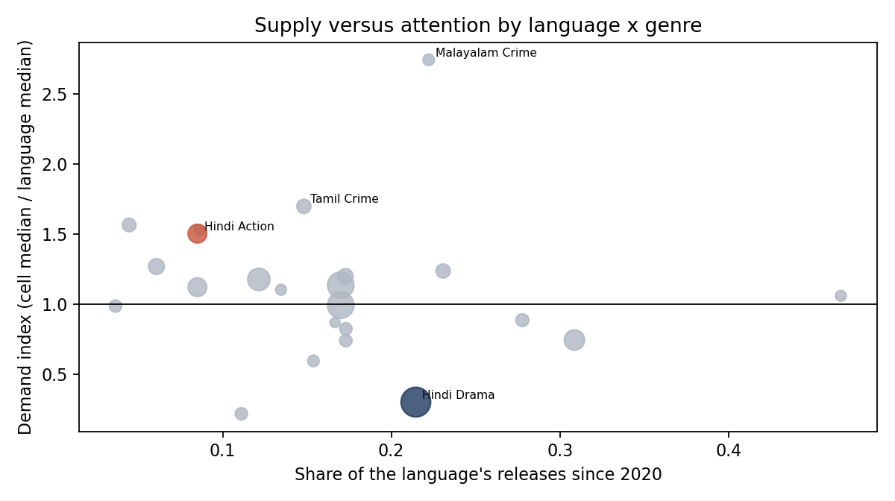

# The Indian OTT Content Intelligence Observatory

What distinguishes Indian streaming originals that launch to strong public attention? A relational database of 998 titles across eleven services (2018–2026), a time-stamped public-attention proxy, and an analysis of what goes with a strong launch.

> **Read this first.** No Indian platform publishes comparable viewership. "Launch attention" here is English-Wikipedia pageviews of a title's article in the 28 days from release. It measures public interest, favours English-reading audiences, and is not viewership.

## Business problem
Content teams decide what to commission with little public evidence on which characteristics go with audience interest. This project builds that evidence from open data and is explicit about how far it goes.

## Research question
Which observable characteristics (language, genre, format, platform, cast, franchise status) distinguish Indian OTT titles with stronger public demand indicators, and can a strong launch be anticipated before release?

## Why it matters
Slate decisions on genre mix, language expansion and film-versus-series formats are made every quarter. Even a rough, bias-aware external benchmark helps a development team challenge its own assumptions.

## Data
| Source | Used for | Licence | In repo |
|---|---|---|---|
| English Wikipedia categories and infoboxes | Title frame, metadata | CC BY-SA 4.0 | Derived fields |
| Wikidata | Country, identifiers | CC0 | Derived fields |
| Wikimedia Pageviews API | Launch attention, cast prominence | CC0 | Window sums |
| IMDb ratings file | Proxy validation only | Non-commercial, no redistribution | No |
| Netflix Top 10 by country | Proxy validation only | Redistribution not stated | No |

All retrieved 11 November 2026. Details: `docs/source_register.csv`, `docs/data_dictionary.md`, `data/README.md`.

- 2,682 candidate pages from 22 platform-originals categories → 1,078 Indian title pages → 998 released January 2018 to October 2026 → 920 scripted → **502 with measurable launch attention** (article existed on release day).
- Database: `data/processed/ott_observatory.sqlite` (14 tables, schema in `sql/schema.sql`); query library in `sql/analysis_queries.sql` (CTEs, window functions).

## Methodology
Group comparisons (medians, Kruskal-Wallis); OLS on log launch attention with platform, language, genre, format, cast prominence and year effects (HC3 errors); a strong-launch classifier trained on 2018–2023 and tested on 2024–2026 using only pre-release information; and a within-language supply-versus-attention index with bootstrap intervals. Full detail: `docs/methodology.md`.

## Key findings
- **Titles billed first as "drama" draw the least launch attention.** With other characteristics held constant, action draws 2.4x a drama (95% CI 1.5–3.8), horror 2.2x (1.3–3.5) and crime 2.0x (1.2–3.4).
- **Hindi drama is over-supplied relative to attention:** 21% of Hindi releases since 2020 at 0.30x the Hindi median (CI 0.16–0.69). Hindi action is thinly supplied (9%) at 1.51x (CI 1.05–3.79).
- **Films open bigger, series last longer.** Median 180,000 vs 41,000 pageviews; after controls the gap (0.74x, CI 0.50–1.11) is no longer statistically clear.
- **Tamil is not distinguishable from Hindi after controls** (0.93x, CI 0.63–1.38).
- **Sequels and remakes show no association** with launch attention after controls (0.77x, CI 0.38–1.54); lead-cast prominence does (1.35x per tenfold increase, CI 1.10–1.64).
- **A strong launch is partly predictable before release** (ROC AUC 0.84, CI 0.77–0.91, on 156 held-out 2024–2026 titles), but platform alone gives 0.75 and within Netflix the model manages only 0.63.
- **The proxy has limits:** it correlates 0.71 with IMDb vote counts but not reliably with weeks in Netflix's India Top 10 (0.12, n = 54).
- Median launch attention fell from roughly 150,000–180,000 (2020, 2021, 2023) to under 60,000 (2024–2026); demand and declining Wikipedia use cannot be separated.



## Dashboard
**No Tableau workbook is included**; Tableau was not available when this was built. `tableau/` holds Tableau-ready CSVs, calculated-field definitions and a seven-page specification with a wireframe. Figures in `reports/figures/` are static matplotlib charts.

## Business implications
`reports/executive_report.md`, `reports/content_opportunity_briefs.md` (three briefs graded by strength of evidence) and `reports/executive_presentation.pptx`.

## Limitations
Proxy is not viewership and has an English-language bias; only 55% of scripted titles are measurable and coverage differs by platform; metadata is parsed from free text; all results are associations. Full list: `docs/limitations.md`.

## Reproduce
```bash
python -m venv .venv && source .venv/bin/activate
pip install -r requirements.txt
export WIKIMEDIA_CONTACT="https://your-site-or-email"   # Wikimedia allows ~10 requests/min without it
python -m ott_intel.collect_frame        # run from the repo root with PYTHONPATH=src
python -m ott_intel.build_titles
python -m ott_intel.collect_pageviews
# place IMDb title.ratings.tsv.gz and Netflix all-weeks-countries.tsv in data/raw/ (see data/README.md)
python scripts/run_analysis.py           # dataset, SQLite DB, analysis outputs, figures
python scripts/build_deck.py
pytest -q
```
Wikipedia changes daily, so a fresh collection will not reproduce the counts exactly. `data/processed/titles.csv` is the frozen dataset behind the reported results; analysis functions can be run on it directly (the proxy-validation step needs the two local files).

## Repository layout
```
docs/       problem definition, methodology, data dictionary, sources, limitations, decisions
src/        ott_intel package: collectors, parser, dataset builder, database loader, analysis
sql/        schema and query library
data/       processed dataset and SQLite database (raw data excluded)
scripts/    run_analysis.py, build_deck.py
notebooks/  executed walkthrough
tableau/    Tableau-ready data, calculated fields, dashboard specification
reports/    executive report, opportunity briefs, presentation, figures
tests/      parser, dataset integrity, leakage and database tests
```

## Tools
Python (pandas, NumPy, SciPy, statsmodels, scikit-learn, matplotlib), SQLite, pytest. Tableau specification only.

Metadata derived from Wikipedia is © Wikipedia contributors, CC BY-SA 4.0.
